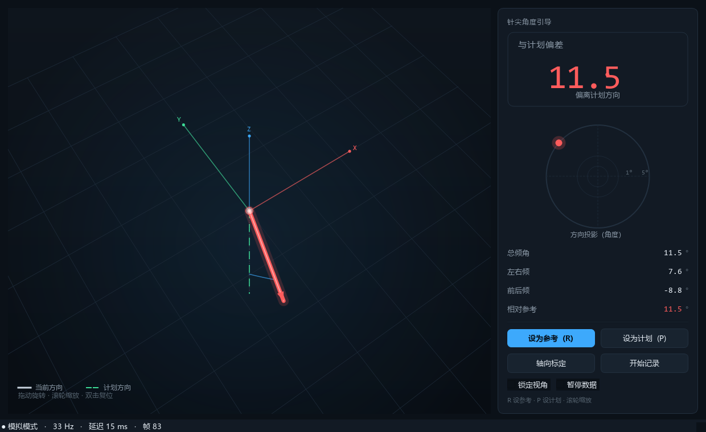

# WT9011DCL-BT50 姿态采集与产品接入（Windows + Python）

把「维特智能 WT9011DCL-BT50 蓝牙姿态传感器 → Windows → Python → 你的产品」这条链路，
做成一个可以直接接进产品的 SDK，外加针体位姿几何、诊断工具和一套不需要传感器的自测。

```python
from wt901 import WT901, WT901Config

with WT901(WT901Config(address="AA:BB:CC:DD:EE:FF")) as imu:
    r = imu.read(timeout=2.0)
    print(r.roll, r.pitch, r.yaw, r.ax, r.gy)
```

> 硬件相关的关键参数（Notify UUID、帧格式、±16g/±2000dps 量程）要在实物上确认一次，
> 用 `python -m wt901 probe` 一次跑完，见 [docs/02-实物联调清单.md](docs/02-实物联调清单.md)。

---

## 1. 这个项目解决什么

| 环节 | 做法 |
| --- | --- |
| SDK | `WT901`（阻塞）/ `AsyncWT901`（asyncio），同一套能力，见 [docs/03-SDK参考.md](docs/03-SDK参考.md) |
| 连接 | `bleak` 连接 BLE，自动发现 Notify 特征值，断线自动重连（指数退避） |
| 诊断 | `wt901 probe`：枚举 GATT、抓包、自动判定帧格式/速率/量程 |
| 解析 | 支持 `0x55 0x61` 20 字节合并帧、`0x55 0x51/0x52/0x53/0x54/0x59` 11 字节分帧（带校验和；0x59 为四元数） |
| 抗干扰 | 逐字节重同步、校验和校验、缓冲区上限、坏帧/丢字节统计 |
| 校准 | 陀螺零偏、角度归零、JSON 持久化 |
| 针体位姿 | `pose.py`：四元数、针轴两姿态标定、针尖运动学，见 [docs/04-穿刺针位姿引导-技术方案.md](docs/04-穿刺针位姿引导-技术方案.md) |
| 传感器↔模型映射 | `mapping.py`：设备四元数 → 针轴 → 完整相对旋转（含滚转），见 [docs/08-坐标转换方案.md](docs/08-坐标转换方案.md) |
| 低延迟 | 最新值覆盖 + 30 fps 轮询 + 模型降面 + 状态栏主机延迟/跳过/渲染耗时，见 [docs/09-延迟分析与优化.md](docs/09-延迟分析与优化.md) |
| 旋转中心 | 针座 / 针尖两种模式；只改渲染枢轴，不改四元数与角度，见 [docs/10-针尖旋转模式.md](docs/10-针尖旋转模式.md) |
| 样机界面 | `gui/`：PySide6 角度引导界面（3D 针/STL 模型、偏差、四元数、竖直标定、日志、记录），见 [docs/05-样机使用说明.md](docs/05-样机使用说明.md) |
| 控制 | 阈值 + 滞回 + 斜坡限速 + 数据超时 + 倾角安全切除 |
| 输出 | 控制台、CSV、JSONL、TCP（JSON/文本行），可插拔 |
| 安全 | 数据超时/断线/退出 → 立即 STOP；指令带心跳，便于下游做看门狗 |
| 验证 | 207 个单元测试 + `wt901 selftest` + GUI 离屏冒烟（无硬件、无蓝牙依赖） |

## 2. 目录结构

```
wt901_control/
├─ src/wt901/
│  ├─ sensor.py       ★ SDK：WT901 / AsyncWT901 / ImuReading / 校准
│  ├─ probe.py        ★ 诊断：GATT 枚举 + 抓包 + 帧格式判定
│  ├─ ble.py          ★ BLE 设备 profile（FFE5/FFE4/FFE9）+ FF AA 命令帧
│  ├─ devices.py      ★ 上次设备缓存（跳过扫描）
│  ├─ pose.py         ★ 针体位姿几何：四元数、针轴标定、针尖运动学
│  ├─ mapping.py      ★ 传感器↔针模型映射：显示系、完整相对旋转、竖直标定
│  ├─ estimator.py    ★ 角度跟踪：姿态 → 针轴方向 → 倾角/偏差（含平滑）
│  ├─ gui/            ★ PySide6 样机：3D 针体、偏差仪表、标定向导
│  ├─ protocol.py     帧编码/解码、重同步、统计
│  ├─ state.py        最新值缓存（把 0x51/0x52/0x53 拼成一份完整状态）
│  ├─ controller.py   姿态 → 指令的状态机（滞回/限速/失效保护）
│  ├─ sinks.py        控制输出：console / JSONL / TCP
│  ├─ recorder.py     CSV 记录
│  ├─ transport.py    BLE 连接（bleak，延迟导入）
│  ├─ simulator.py    无硬件数据源
│  ├─ app.py          装配与主循环（数据传输 + 固定周期控制）
│  └─ cli.py          命令行入口
├─ examples/          quickstart / product_loop / control_demo
├─ tests/             单元测试（无需硬件）
└─ docs/              需求整理、技术方案、联调清单、SDK 参考、针体位姿
```

## 3. 文档

| 文档 | 内容 |
| --- | --- |
| [docs/03-SDK参考.md](docs/03-SDK参考.md) | **接入必读**：API、线程模型、重连语义、校准、错误处理、集成形态 |
| [docs/06-BLE通信参数.md](docs/06-BLE通信参数.md) | **本机实测参数**：UUID、帧格式、速率、量程、连接耗时、写入协议 |
| [docs/04-穿刺针位姿引导-技术方案.md](docs/04-穿刺针位姿引导-技术方案.md) | **针体位姿**：能力边界、运动学、标定、GUI、精度预算、里程碑 |
| [docs/05-样机使用说明.md](docs/05-样机使用说明.md) | **样机操作**：启动、界面读数、参考/计划、标定、数据中断、已知限制 |
| [docs/08-坐标转换方案.md](docs/08-坐标转换方案.md) | **坐标映射**：CAD/传感器/显示系、完整相对旋转、四元数、竖直标定与排查 |
| [docs/09-延迟分析与优化.md](docs/09-延迟分析与优化.md) | **延迟**：端到端预算、队列数学、BLE/渲染测量、最新值覆盖与 ODR 调整 |
| [docs/10-针尖旋转模式.md](docs/10-针尖旋转模式.md) | **tip pivot**：绕针尖/针座的坐标变换、UI、验收与边界 |
| [docs/00-需求整理.md](docs/00-需求整理.md) | 诉求归类、事实状态、交付范围、里程碑与验收标准 |
| [docs/01-技术方案.md](docs/01-技术方案.md) | 帧格式、解析策略、时序设计、控制状态机、失效处理、输出契约 |
| [docs/02-实物联调清单.md](docs/02-实物联调清单.md) | 拿到硬件后的逐步核对流程、通过标准、排查表 |

## 4. 安装/启动

### 最快：不安装，用启动器

- **`start_real.cmd`**：连真实传感器（设备名 `WT901BLE67`）
- **`start_gui.cmd`**：模拟模式，不接硬件

```bat
cd /d <本目录>
start_real.cmd                :: 接 WT901BLE67 采数据
start_gui.cmd                 :: 模拟数据

wt901.cmd --version           :: 其他命令同一入口
wt901.cmd scan
wt901.cmd probe --name WT901BLE67 --duration 6
```

启动器自己把 `PYTHONPATH` 指向 `<本目录>\src`，**与当前工作目录无关**，也不用先 `pip install`。

### 也可以装进虚拟环境

```powershell
cd <本目录>
python -m venv .venv
.\.venv\Scripts\python.exe -m pip install --upgrade pip
.\.venv\Scripts\python.exe -m pip install -e ".[ble]"
```

装好后 `wt901` 命令就在 `.venv\Scripts\` 下。如果 PowerShell 禁止激活虚拟环境，
始终用 `.\.venv\Scripts\python.exe` 调用，不要用 `Activate.ps1`。

没有安装 `bleak` 也能跑：解析、模拟器、自测、GUI 模拟模式都不依赖它。

### 手动方式（必须 `cd` 到本目录）

```powershell
cd <本目录>
$env:PYTHONPATH="$PWD\src"
python -m wt901 gui --sim
```

> **`No module named wt901` 的唯一原因**：当前目录不是本目录，或 `PYTHONPATH`
> 没指到 `<本目录>\src`。在 `C:\Users\你` 下执行 `$env:PYTHONPATH="$PWD\src"`
> 得到的是 `C:\Users\你\src`，自然找不到。用 `wt901.cmd` 可以完全避开这个坑。

## 5. 五分钟验证（不需要传感器）

```powershell
# 端到端自检：模拟器 → 解析 → 控制 → 指令输出
.\wt901.cmd selftest

# 观察完整链路，6 秒后自动停止
.\wt901.cmd sim --duration 6

# 解析一段抓包数据
.\wt901.cmd analyze --hex "55 61 00 00 00 00 00 40 00 00 00 00 00 00 10 27 00 00 00 00"
```

`selftest` 全 PASS 说明解析、状态缓存、控制状态机和装配没问题，剩下的风险只在硬件侧。

## 6. 接真实传感器

本机已用 **WT901BLE67** 实测通过，参数固定为：

| 项 | 值 |
| --- | --- |
| 设备名 / 地址 | `WT901BLE67` / `EA:D7:22:40:D3:0A` |
| 服务 / 通知 / 写 | `0ffe5` / `0ffe4` / `0ffe9`（基址 `...9a34fb`） |
| 帧格式 | `0x55 0x61`，20 字节，无校验和 |
| 速率 / 量程 | 10 Hz；±16 g / ±2000 °/s / ±180° |

```batch
start_real.cmd                          :: 直接连 WT901BLE67
wt901.cmd probe --name WT901BLE67 --duration 6   :: 复测参数
```

完整参数、连接耗时、写入协议见 [docs/06-BLE通信参数.md](docs/06-BLE通信参数.md)。

换设备或参数变了，先用 `probe` 重新确认：

```powershell
python -m wt901 scan                 # 1. 找地址
python -m wt901 probe --name WT901BLE67   # 2. UUID/帧格式/速率/量程
```

`probe` 会打印服务列表、每个特征值收到多少字节、解析出的帧类型、速率、
`|accel|` 是否接近 1 g，并给出可直接照抄的 `notify_uuid`。把报告贴回来就能判断下一步。

拿到参数后：

```powershell
python -m wt901 run --address AA:BB:CC:DD:EE:FF --notify-uuid <UUID> --csv data.csv
```

首次联调也可以边跑边抓：

```powershell
python -m wt901 run --address AA:BB:CC:DD:EE:FF --dump-hex --capture raw.bin
python -m wt901 analyze --file raw.bin --limit 5
```

完整核对流程见 [docs/02-实物联调清单.md](docs/02-实物联调清单.md)。

常用参数：

| 参数 | 默认 | 说明 |
| --- | --- | --- |
| `--axis` | `pitch` | 用哪个角做控制量 |
| `--threshold` | `15` | 触发阈值（度） |
| `--hysteresis` | `3` | 回差，防止临界抖动 |
| `--stale-timeout` | `0.5` | 多久没有新姿态就判失效（秒） |
| `--tilt-limit` | `60` | 倾角超过即强制 STOP |
| `--slew` | `2.0` | 指令斜坡速度（归一化/秒） |
| `--rate` | `50` | 控制循环频率（Hz） |
| `--csv` | — | 采样数据落盘 |
| `--capture` | — | 原始字节落盘，供 `analyze` 复盘 |
| `--tcp HOST:PORT` | — | 把指令推给下游控制器 |
| `--notify-uuid` | 自动 | 自动选择有歧义时手工指定 |

## 7. 样机界面（角度引导）



```powershell
.\wt901.cmd gui --sim                       # 无硬件预览
.\wt901.cmd gui --address AA:BB:CC:DD:EE:FF # 接真实传感器
```

- 大数字 = 与计划方向的**总偏差**，并给出方向词（右上/左下…）；下面两行是 **φ 左右（右+）** 与 **ψ 上下（上+）**，可直接指导往哪边调
- 「连接蓝牙 / 断开连接」手动控制采集；「导入模型 / 导入基座」支持 **STL / STEP / glTF**（STEP 需 `cascadio`，glTF 需 `trimesh`）
- 姿态面板显示四元数 W/X/Y/Z；日志面板记录连接、导入、断流等事件
- **拖动视角时，针、坐标轴、网格作为刚体一起旋转**，角度读数不受视角影响
- 「锁定视角」固定画面；「暂停数据」冻结姿态，且不会因超时变成 NO DATA
- 数据超过 0.4 s 未更新：横幅 + 视图变灰 + NO DATA，**不会**停在上一帧
- 详见 [docs/05-样机使用说明.md](docs/05-样机使用说明.md)

## 8. 控制指令协议（下游对接用）

TCP（`--tcp 127.0.0.1:9000`）每行一条 JSON，200 ms 心跳重发：

```json
{"seq": 42, "cmd": "FWD", "value": 1.0, "valid": true, "reason": "hold_fwd", "t": 1762000000.123}
```

`cmd` 只有 `FWD` / `REV` / `STOP`；`value` 是斜坡后的 -1.0~+1.0；
`valid=false` 表示数据失效（超时/断线），下游必须按 STOP 处理。

CSV（`--csv`）列：时间戳、序号、姿态角、加速度、角速度、磁场、温度、当前指令。

## 9. 测试与示例

```powershell
$env:PYTHONPATH="$PWD\src"
python -m unittest discover -s tests -v

python examples\quickstart.py --sim      # SDK 冒烟
python examples\product_loop.py --sim    # 产品主循环形态
python examples\control_demo.py --sim    # 姿态 → 指令
```

207 个用例覆盖：帧编解码、校验和、重同步、逐字节 Feed、缓冲上限、阈值/滞回/斜坡/
超时/倾角保护、CSV 写出、SDK 同步与异步、校准、重连、抓包分析、四元数与针轴标定、
角度跟踪，以及 GUI 的离屏冒烟测试（模拟数据贯通到渲染）。

## 10. 已知边界

- Windows + BLE 不是硬实时链路：定时器粒度约 15.6 ms，链路延迟要在实物上实测。
- 单颗 IMU 只能给姿态，给不出位置；针尖位置需要入点 + 深度（见 docs/04）。
- 本项目不替代执行机构一侧的硬件限位、急停和独立看门狗。
- 量程/帧格式/UUID 三个参数必须用实物核对，代码默认值只是合理猜测。
- 商用前请自行确认官方 SDK/资料的授权条款。
