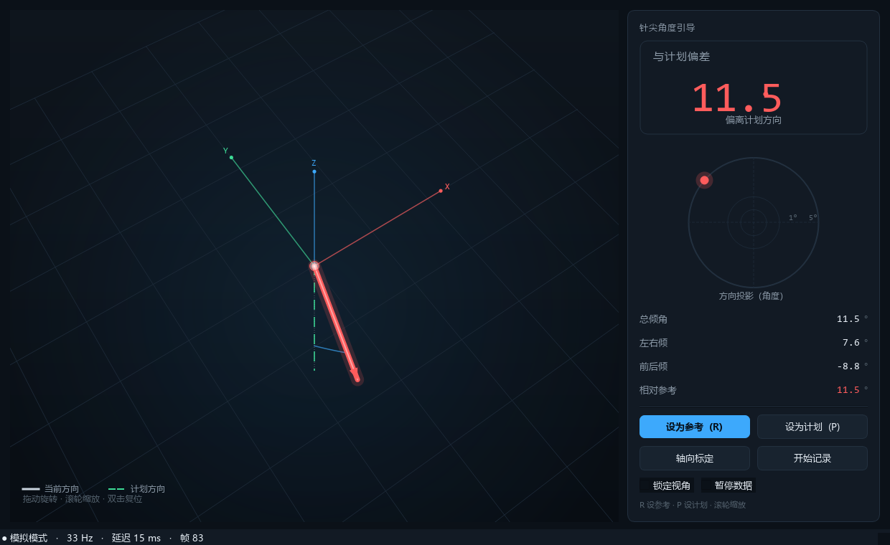
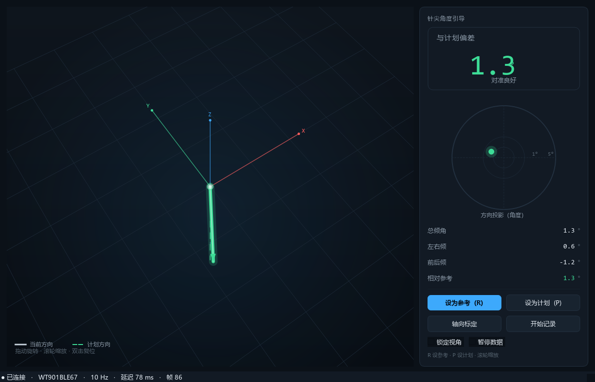
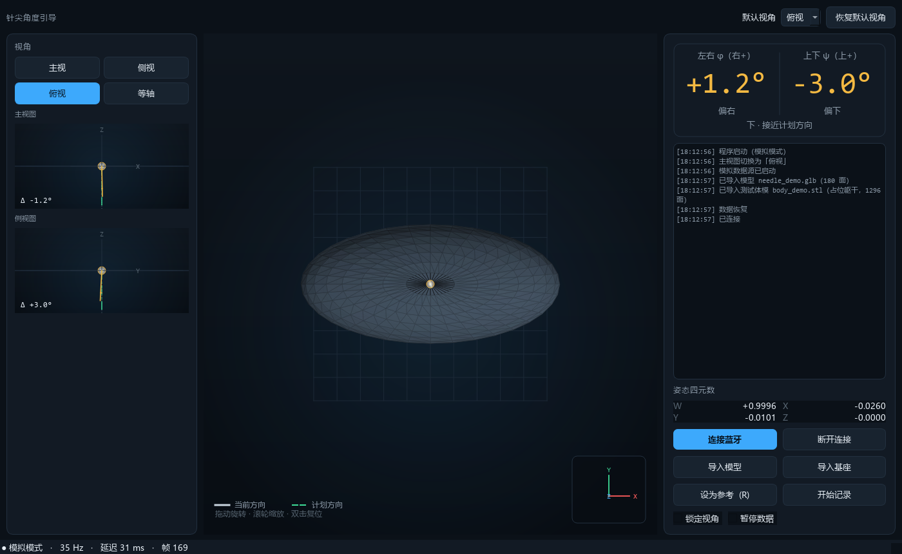
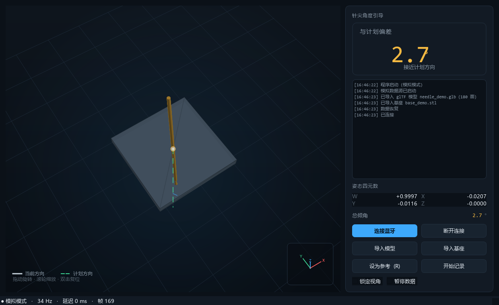
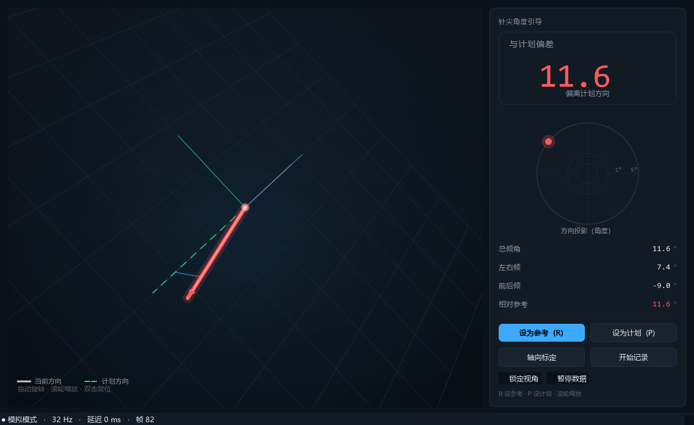

# 样机使用说明（角度引导 v0.1）



适用前提（已与你确认）：**刚性针、只看角度、不做深度、先出样机**。
因此本样机不计算针尖位置，只回答一个问题：*现在这个方向，和计划方向差多少度？*

---

## 1. 启动

### 方式 A：用启动器（推荐，零配置）

进入 `wt901_control` 文件夹：

- **双击 `start_real.cmd`**：连真实传感器（`WT901BLE67`），本机已实测可用
- **双击 `start_gui.cmd`**：模拟模式，不需要硬件

或在资源管理器地址栏输入 `cmd` 后：

```bat
cd /d C:\Users\Otronic-ZhangCong\Documents\deepseek-harness\default-workspace\wt901_control

start_real.cmd                                  :: 接 WT901BLE67
start_gui.cmd                                   :: 模拟模式
start_gui.cmd --address AA:BB:CC:DD:EE:FF       :: 指定地址
```

启动器会自动把 `PYTHONPATH` 指向本目录下的 `src`，**与当前工作目录无关**，
也不需要先 `pip install`。

真实设备首次启动需要 **10–13 秒**（扫描 + 连接），状态栏会显示"查找 WT901BLE67 …"；
连上后显示"● 已连接 · WT901BLE67 · 10 Hz"。之后的启动会走设备缓存，快一些。



> 上图是 2026-11-05 用 `start_real.cmd` 实采的界面：`WT901BLE67`、10 Hz、偏差 1.3°。

其他命令用同一套：

```bat
wt901.cmd --version
wt901.cmd scan
wt901.cmd probe --name WT901BLE67 --duration 6
wt901.cmd gui --sim
```

### 方式 B：手动设置环境

```powershell
cd C:\Users\Otronic-ZhangCong\Documents\deepseek-harness\default-workspace\wt901_control
$env:PYTHONPATH="$PWD\src"        # 必须是 wt901_control\src，不是 src\wt901

python -m wt901 gui --sim
python -m wt901 gui --address AA:BB:CC:DD:EE:FF
```

> 注意：`$PWD\src` 取决于**当前目录**。在 `C:\Users\Otronic-ZhangCong` 下执行，
> 得到的是 `C:\Users\Otronic-ZhangCong\src`，于是就会报 `No module named wt901`。
> 一定要先 `cd` 到项目根，或者直接用方式 A。

参数：

| 参数 | 说明 |
| --- | --- |
| `--address` / `--name` | 指定设备，`name` 默认 `WT901` |
| `--sim` | 模拟数据源，不需要硬件 |
| `--sim-amp` / `--sim-period` | 模拟倾角幅度/周期，做演示用 |
| `--screenshot PATH` | 截图后退出（自测/文档用） |
| `--duration N` | N 秒后自动退出 |

## 2. 界面（2026-11-06 多视图版）



| 区域 | 内容 | 读法 |
| --- | --- | --- |
| 顶部工具栏 | 默认视角（俯视/主视/侧视）+「恢复默认视角」 | 选定后主视图立即切换；双击视图也会回到该默认 |
| 左侧「切换主视图」 | 主视 / 侧视 / 俯视 / 等轴 四个按钮（高亮当前） | **只切换中间大视图**，小视图固定不动 |
| 左侧主视图 | 小窗，固定正视，**不可拖动**；显示已导入的模型与基座 | 带 X/Z 直角坐标，左下角显示该平面内与计划的夹角 Δ |
| 左侧侧视图 | 小窗，固定侧视，**不可拖动**；显示已导入的模型与基座 | 带 Y/Z 直角坐标，左下角显示该平面内与计划的夹角 Δ |
| 主视图 | 大视图，默认**俯视** | 拖动旋转、滚轮缩放；导入模型后自动缩放到合适距离 |
| 右侧偏差卡 | **左右 φ（右+）**、**上下 ψ（上+）** 两列大数字 | 例：φ **+1.2°** 偏右、ψ **−3.1°** 偏下 |
| 日志 | 连接/断开、视角切换、导入模型、记录等事件 | 带时间戳，最多 400 行 |
| 姿态四元数 | W / X / Y / Z | **相对参考姿态、显示系**的旋转，参考时为 `1,0,0,0`；可直接给下游 |
| 状态栏 | 模拟/已连接、速率、**主机延迟**、帧数、**跳过**、**渲染 ms** | `主机延迟` 不随时间增大；`跳过` 增长说明 GUI 在合并旧帧；`渲染` > 50 ms 要降面数/换 OpenGL |
| 旋转中心 | 下拉：**针座 (hub)** / **针尖 (tip)** | hub=绕针座转；tip=绕针尖转（针尖在显示原点），见 [docs/10-针尖旋转模式.md](10-针尖旋转模式.md) |

> 2026-11-08 调整：两个小视图也会绘制导入的模型（内部自动降采样到 1200/600 面以保证帧率），
> 且鼠标不可拖动/缩放；左上四个按钮只切换主视图；新增「针轴反向」用于现场校正方向。
> 同一版新增「标定针轴（竖直）」与四元数优先映射，见 [docs/08-坐标转换方案.md](08-坐标转换方案.md) 第 8 节。
>
> 低延迟版：采集线程只保留**最新一帧**，GUI 以约 30 fps 轮询并主动丢掉中间帧；
> 模型简化到 3000 面、小视图 600 面；平滑 20 ms。状态栏新增 `主机延迟 / 跳过 / 渲染`，
> 原理与 BLE 排查见 [docs/09-延迟分析与优化.md](09-延迟分析与优化.md)。
>
> 0.6.0 新增「旋转中心」：针座 / 针尖两种模式。切换只改变渲染枢轴平移，不改变四元数、针轴和角度；
> 详见 [docs/10-针尖旋转模式.md](10-针尖旋转模式.md)。

> 2026-11-06 布局调整：新增左侧三视图面板与顶部默认视角选择；主视图默认俯视；
> 原来的单一总角度大数字已删除，φ/ψ 成为主显示。

### 测试模型

目录 `examples/` 下有三个可直接导入的模型：

| 文件 | 内容 | 面数 |
| --- | --- | --- |
| `body_demo.stl` | **占位躯干**（480×220×180 mm 椭球，仅用于测试导入/视角，不是解剖模型） | 1296 |
| `needle_demo.stl` / `.glb` | 150 mm 针 | 180 |
| `base_demo.stl` | 90×90×8 mm 底座 | 12 |
| `base_box.stl` / `.glb` | **120×80×10 mm 长方体基座**（顶面在 z=0，可直接「导入基座」） | 12 |
| `skull_demo.stl` | **成人头骨**（BodyParts3D，CC BY-SA 2.1 JP；已简化到 8000 面） | 8000 |

生成脚本：`python tools/make_demo_stl.py --out examples`。

### 偏差为什么拆成 φ/ψ

单个角度只有大小、没有方向，"偏 3°" 无法指导往哪边调。所以把偏差投影到计划方向的
**正交截面**上：

```
总偏差 θ = arccos(u · p)          小角度时 θ ≈ √(φ² + ψ²)
左右 φ  = atan2(横向分量 · 右向量, u · p)      右 + / 左 −
上下 ψ  = atan2(横向分量 · 上向量, u · p)      上 + / 下 −
```

"上"以重力为参考（计划方向不是竖直时）；计划方向接近竖直时退化为显示系的 Y 轴，
此时 ψ 实际表示"前后"。方向词由 (φ, ψ) 落在 8 个扇区中的哪一个自动生成（上/右上/右/…）。

按钮：

| 按钮 | 作用 |
| --- | --- |
| 连接蓝牙 / 断开连接 | 手动控制采集线程；断开后状态栏显示"未连接" |
| 导入模型 | 载入针体模型（**STL / STEP / glTF**）；自动缩放到 170 mm 并把包围盒中心放到原点（原点因此位于模型内部） |
| 导入基座 | 载入底座模型（**STL / STEP / glTF**）；保持原始尺寸，**顶面贴在 z=0 平面** |
| 标定针轴（竖直） | 把针竖直向下放稳后点击；用重力反解针轴在传感器系的方向，写入 `config/rig.json`，并重新定参考 |
| 旋转中心 | 选择 **针座 (hub)** 或 **针尖 (tip)**；选择写入 `config/rig.json` 的 `pivot_mode` |
| 设为参考 (R) | 当前姿态定为 0° |
| 开始记录 | 记录四元数、倾角、偏差到 CSV |

> 导入的模型会跟着姿态一起旋转；有模型时不再画示意针线，避免重复。
> 演示用模型：`examples/needle_demo.stl`、`examples/base_demo.stl`。

### 传感器四元数与模型映射

- 设备若输出 **0x59 四元数帧**（`55 59 q0..q3 SUM`，`q0=w`，`/32768`），界面直接使用四元数，
  不再从欧拉角现算；没有四元数时自动退回 `roll/pitch/yaw`。
- 模型旋转使用**完整相对旋转**（含绕针轴的滚转），不是"把模型针轴转到当前针轴"的最短弧。
  因此带手柄/PCB 的整支针在滚针时也会跟着转；详见
  [docs/08-坐标转换方案.md](08-坐标转换方案.md) 第 8 节。
- 姿态面板显示的四元数是**相对参考姿态**的显示系旋转，参考时为 `(1,0,0,0)`；便于直接给下游。
- 若设备四元数是"世界→传感器"约定，把 `config/rig.json` 的 `invert_quaternion` 改成 `true`。

### 模型格式支持：STL / STEP / glTF

| 格式 | 依赖 | 说明 |
| --- | --- | --- |
| **STL** | 无 | 直接读三角面，零额外依赖 |
| **STEP / STP** | `cascadio` | B-rep 曲面，需 CAD 内核三角化（转换在临时目录完成） |
| **glTF / GLB** | `trimesh` | 读取节点变换并合并三角面；**单位自动判断**（最大尺寸 ≤1 视为米，×1000 转 mm） |

```powershell
python -m pip install cascadio trimesh
```

没装对应后端时，选到该格式会弹窗提示安装命令，**不会崩溃**；也可以先在 CAD/建模软件里
另存为 STL 再导入（无需任何额外依赖）。

已验证的真实文件：

- `tests/assets/material.stp`（cascadio 官方示例）→ 12 面
- `examples/needle_demo.glb`（由 `needle_demo.stl` 转换）→ 180 面，150 mm，渲染见下图



颜色：**绿 < 2°，橙 2–5°，红 ≥ 5°**。阈值写在 `gui/widgets.py` 的 `color_for_deviation`，可直接改。

### 视角：拖动时针与坐标系一起转

拖动鼠标，**针、坐标轴、网格作为同一个刚体一起旋转**；右侧的角度读数不受视角影响
（转完还是同一个角度）。

> 之前版本有个视觉问题：水平拖动是绕**世界 Z 轴**转，而针轴恰好也是 Z 轴，所以针在
> 屏幕上原地不动、只有网格绕它转，看起来像"针被钉住、坐标系自己在转"。
> 现在改成绕**屏幕轴**旋转（轨迹球），两者就会一起转。



勾选「锁定视角」可以固定画面（拖动不再旋转）；勾选「暂停数据」冻结姿态，
冻结时**不会**因为超时变成 NO DATA。

## 3. 操作流程

1. **夹装**：把传感器固定到针座（红圈位置）。夹持件必须防转，装好后目视确认针不能在夹子里转动。
2. **启动**：`python -m wt901 gui --address ...`
3. **设为参考（R）**：把针摆到术前的初始姿态（比如垂直向下），按 R。此后所有角度都相对这个姿态，磁北漂移不影响。
4. **设为计划（P）**：把针摆到你想要的目标方向，按 P。之后大数字显示的就是"当前方向 vs 计划方向"。
5. **操作中**：只看大数字和靶心；红色即偏离超 5°。

> 也可以在已知计划角度时，先按 R 归零，再按 P 记录"当前"，用楔块/量角器把计划方向摆出来。

### 一直显示“连接中”怎么办

最常见原因是**设备被占用**：维特智能上位机（`WitMotion.exe`）或手机 App 还连着传感器。
BLE 外设同一时刻只允许一个连接，被占用时**停止广播**，Windows 甚至枚举不到它。

处理：关掉上位机/手机 App —— 本程序会自动重连，**不用重启**，几秒到十几秒内恢复。

排查命令：

```bat
wt901.cmd probe --name WT901BLE67 --duration 6    :: 扫不到就是被占用/未上电
```

详见 [docs/06-BLE通信参数.md](06-BLE通信参数.md) 第 8 节（含实测截图）。

## 4. 标定（可选，但建议做一次）

`config/rig.json` 的默认值来自总装几何：**针轴在传感器系为 +Y**
（`needle_axis_sensor=(0,1,0)`，hub → tip）。如果实际安装方向不同，用竖直法标定：

1. 把针**竖直向下**放稳（铅垂线或直角块辅助）；
2. 点「标定针轴（竖直）」；
3. 程序用 `s = Rᵀ · (0,0,−1)` 反解针轴在传感器系中的方向，写入 `config/rig.json`，
   并自动重新设为参考。

竖直法的好处：只依赖重力方向，**不需要磁力计、不需要知道朝向**。
标定后做两项一致性检查：

- 倾斜 30°（用楔块）：界面倾角应在 30° ± 1°；
- 左右/前后各倾一次：模型倾斜方向必须与实物一致，不能镜像。

> 若"往右倾、界面往左"，先试「针轴反向」；仍不对则把 `invert_quaternion` 设为 `true`。
> 完整排查顺序见 [docs/08-坐标转换方案.md](08-坐标转换方案.md) 第 8.6 节。

## 5. 数据中断

数据超过 **0.4 s** 没更新：

- 顶部出现红色横幅「数据中断」；
- 3D 视图变灰并显示 **NO DATA**；
- 大数字变灰。

**不会**停在上一帧假装还有数据——这是这类辅助界面最重要的行为。

## 6. 记录

点「开始记录」，选择 CSV 路径。列：

```
t_wall, qw, qx, qy, qz, tilt_deg, deviation_deg, phi_deg, psi_deg
```

`qw..qz` 是**相对参考姿态、显示系**的四元数（参考时为 `1,0,0,0`），
`phi/psi` 是左右/上下偏差。UTF-8 BOM，Excel 直接打开。

## 7. 已知限制（如实说明）

1. **没有位置**：本版不做深度、不做针尖坐标，属于设计范围而非缺陷。
2. **姿态优先用设备四元数**：设备发 `0x59` 时直接使用融合四元数；只有 `0x61/0x53`
   时退回 ZYX 欧拉角。轴向/符号与预期不符时，先按「标定针轴（竖直）」，
   仍不对再查 `config/rig.json` 的 `invert_quaternion` / `needle_axis_sensor`。
3. **航向依赖陀螺**：相对参考后不再依赖磁北，但长时间（> 10 min）会有缓慢漂移；
   术前按一次 R 即可重置。
4. **没有做磁干扰检测**：当前不启用磁力计，因此不受手术室金属影响，代价是没有绝对航向——本场景不需要。
5. **未做温度补偿**：手温、环境温度变化会引起零点变化，长时间操作建议中途重新归零。

## 8. 下一步（建议顺序）

1. **接实物跑一遍**：`probe` → `gui --address ...`，确认角度方向、符号、量级正确（用直角块对照）。
2. **实测漂移**：静止 10 分钟，记录 `tilt_deg` 漂移量，决定是否需要"每 N 分钟提示归零"。
3. **装夹重复性**：同一针拆装 5 次，看参考后的零位偏差，决定夹持件要不要加定位销。
4. **体模验证**：明胶/琼脂 + 量角器，对比界面角度与实际角度（目标 < 1.5°）。
5. 需要针尖位置时，再按 [docs/04](04-穿刺针位姿引导-技术方案.md) 引入深度输入。
