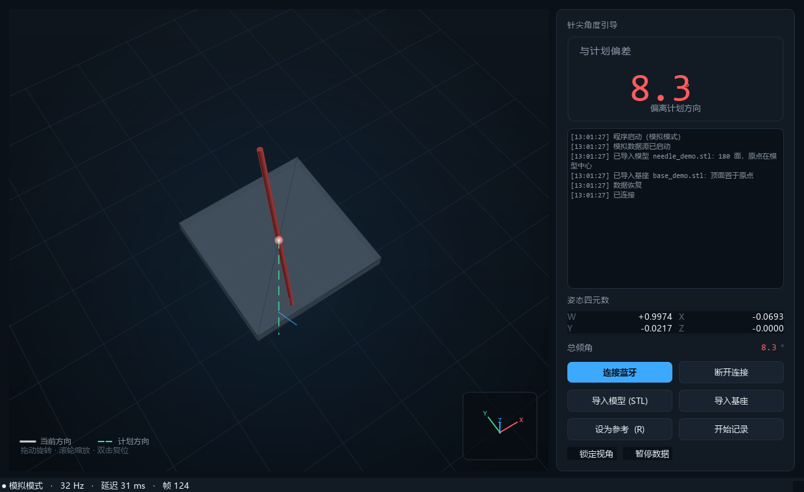

# 样机使用说明（角度引导 v0.1）


适用前提（已与你确认）：**刚性针、只看角度、不做深度、先出样机**。
因此本样机不计算针尖位置，只回答一个问题：*现在这个方向，和计划方向差多少度？*

---

## 1. 启动

### 方式 A：用启动器（推荐，零配置）

进入 `wt901_control` 文件夹：

- **双击 `start_real.cmd`**：连真实传感器（`WT901BLE67`），本机已实测可用
- **双击 `start_gui.cmd`**：模拟模式，不需要硬件

或在资源管理器地址栏输入 `cmd` 后：

```bat
cd /d C:\Users\Otronic-ZhangCong\Documents\deepseek-harness\default-workspace\wt901_control

start_real.cmd                                  :: 接 WT901BLE67
start_gui.cmd                                   :: 模拟模式
start_gui.cmd --address AA:BB:CC:DD:EE:FF       :: 指定地址
```

启动器会自动把 `PYTHONPATH` 指向本目录下的 `src`，**与当前工作目录无关**，
也不需要先 `pip install`。

真实设备首次启动需要 **10–13 秒**（扫描 + 连接），状态栏会显示"查找 WT901BLE67 …"；
连上后显示"● 已连接 · WT901BLE67 · 10 Hz"。之后的启动会走设备缓存，快一些。


> 上图是 2026-11-05 用 `start_real.cmd` 实采的界面：`WT901BLE67`、10 Hz、偏差 1.3°。

其他命令用同一套：

```bat
wt901.cmd --version
wt901.cmd scan
wt901.cmd probe --name WT901BLE67 --duration 6
wt901.cmd gui --sim
```

### 方式 B：手动设置环境

```powershell
cd C:\Users\Otronic-ZhangCong\Documents\deepseek-harness\default-workspace\wt901_control
$env:PYTHONPATH="$PWD\src"        # 必须是 wt901_control\src，不是 src\wt901

python -m wt901 gui --sim
python -m wt901 gui --address AA:BB:CC:DD:EE:FF
```

> 注意：`$PWD\src` 取决于**当前目录**。在 `C:\Users\Otronic-ZhangCong` 下执行，
> 得到的是 `C:\Users\Otronic-ZhangCong\src`，于是就会报 `No module named wt901`。
> 一定要先 `cd` 到项目根，或者直接用方式 A。

参数：

| 参数 | 说明 |
| --- | --- |
| `--address` / `--name` | 指定设备，`name` 默认 `WT901` |
| `--sim` | 模拟数据源，不需要硬件 |
| `--sim-amp` / `--sim-period` | 模拟倾角幅度/周期，做演示用 |
| `--screenshot PATH` | 截图后退出（自测/文档用） |
| `--duration N` | N 秒后自动退出 |

## 2. 界面（2026-11-05 版）



| 区域 | 内容 | 读法 |
| --- | --- | --- |
| 左上大数字 | **与计划偏差** | 唯一需要盯的数；颜色随阈值变化 |
| 日志 | 连接/断开、导入模型、数据恢复、记录等事件 | 带时间戳，最多保留 400 行 |
| 姿态四元数 | W / X / Y / Z | 针体姿态（相对参考、最短旋转），可直接给下游算法 |
| 总倾角 | 相对参考的夹角 | 参考时为 0°，倾斜多少就是多少 |
| 3D 视图 | 针（或导入的 STL）、计划（绿虚线）、参考（灰点线）、夹角弧 | 拖动旋转（针与坐标系一起转）、滚轮缩放、双击复位 |
| 右下角 XYZ | 小型坐标指示器 | 只指示朝向，不占主视图空间 |
| 状态栏 | 模拟/已连接、速率、数据年龄、帧数 | 延迟持续 > 100 ms 要查链路 |

按钮：

| 按钮 | 作用 |
| --- | --- |
| 连接蓝牙 / 断开连接 | 手动控制采集线程；断开后状态栏显示"未连接" |
| 导入模型 (STL) | 载入针体模型；**自动缩放到 170 mm 并把包围盒中心放到原点**（原点因此位于模型内部） |
| 导入基座 | 载入底座模型；保持原始尺寸，**顶面贴在 z=0 平面** |
| 设为参考 (R) | 当前姿态定为 0° |
| 开始记录 | 记录四元数、倾角、偏差到 CSV |

> 导入的模型会跟着姿态一起旋转；有模型时不再画示意针线，避免重复。
> 演示用模型：`examples/needle_demo.stl`、`examples/base_demo.stl`。

颜色：**绿 < 2°，橙 2–5°，红 ≥ 5°**。阈值写在 `gui/widgets.py` 的 `color_for_deviation`，可直接改。

### 视角：拖动时针与坐标系一起转

拖动鼠标，**针、坐标轴、网格作为同一个刚体一起旋转**；右侧的角度读数不受视角影响
（转完还是同一个角度）。

> 之前版本有个视觉问题：水平拖动是绕**世界 Z 轴**转，而针轴恰好也是 Z 轴，所以针在
> 屏幕上原地不动、只有网格绕它转，看起来像"针被钉住、坐标系自己在转"。
> 现在改成绕**屏幕轴**旋转（轨迹球），两者就会一起转。


勾选「锁定视角」可以固定画面（拖动不再旋转）；勾选「暂停数据」冻结姿态，
冻结时**不会**因为超时变成 NO DATA。

## 3. 操作流程

1. **夹装**：把传感器固定到针座（红圈位置）。夹持件必须防转，装好后目视确认针不能在夹子里转动。
2. **启动**：`python -m wt901 gui --address ...`
3. **设为参考（R）**：把针摆到术前的初始姿态（比如垂直向下），按 R。此后所有角度都相对这个姿态，磁北漂移不影响。
4. **设为计划（P）**：把针摆到你想要的目标方向，按 P。之后大数字显示的就是"当前方向 vs 计划方向"。
5. **操作中**：只看大数字和靶心；红色即偏离超 5°。

> 也可以在已知计划角度时，先按 R 归零，再按 P 记录"当前"，用楔块/量角器把计划方向摆出来。

### 一直显示“连接中”怎么办

最常见原因是**设备被占用**：维特智能上位机（`WitMotion.exe`）或手机 App 还连着传感器。
BLE 外设同一时刻只允许一个连接，被占用时**停止广播**，Windows 甚至枚举不到它。

处理：关掉上位机/手机 App —— 本程序会自动重连，**不用重启**，几秒到十几秒内恢复。

排查命令：

```bat
wt901.cmd probe --name WT901BLE67 --duration 6    :: 扫不到就是被占用/未上电
```

详见 [docs/06-BLE通信参数.md](06-BLE通信参数.md) 第 8 节（含实测截图）。

## 4. 标定（可选，但建议做一次）

默认假设：**传感器的 +Z 轴与针轴平行**（见 `NeedleTracker` 默认参数 `needle_axis_sensor=(0,0,1)`）。
如果实际安装方向不同，用竖直法标定：

1. 把针**竖直向下**放稳（铅垂线或直角块辅助）；
2. 点「轴向标定」→「采集竖直姿态」；
3. 程序用 `s = R^T · (0,0,-1)` 反解针轴在传感器系中的方向，并自动重新设为参考。

竖直法的好处：只依赖重力方向，**不需要磁力计、不需要知道朝向**。
标定后可以倾斜 45°（用楔块）验证读数是否也在 45° 附近，这是最简单的一致性检查。

## 5. 数据中断

数据超过 **0.4 s** 没更新：

- 顶部出现红色横幅「数据中断」；
- 3D 视图变灰并显示 **NO DATA**；
- 大数字变灰。

**不会**停在上一帧假装还有数据——这是这类辅助界面最重要的行为。

## 6. 记录

点「开始记录」，选择 CSV 路径。列：

```
t_wall, tilt_deg, tilt_x_deg, tilt_y_deg, deviation_deg, ax, ay, az
```

`ax/ay/az` 是当前方向向量（显示坐标系），便于事后复算。UTF-8 BOM，Excel 直接打开。

## 7. 已知限制（如实说明）

1. **没有位置**：本版不做深度、不做针尖坐标，属于设计范围而非缺陷。
2. **姿态来自设备自带融合**：直接用 WT901 输出的欧拉角（ZYX 假设）。设备内部滤波参数不可见；
   如果实测发现轴向/符号与预期不符，`NeedleTracker(invert_euler=True)` 或调 `needle_axis_sensor` 即可。
3. **航向依赖陀螺**：相对参考后不再依赖磁北，但长时间（> 10 min）会有缓慢漂移；
   术前按一次 R 即可重置。
4. **没有做磁干扰检测**：当前不启用磁力计，因此不受手术室金属影响，代价是没有绝对航向——本场景不需要。
5. **未做温度补偿**：手温、环境温度变化会引起零点变化，长时间操作建议中途重新归零。

## 8. 下一步（建议顺序）

1. **接实物跑一遍**：`probe` → `gui --address ...`，确认角度方向、符号、量级正确（用直角块对照）。
2. **实测漂移**：静止 10 分钟，记录 `tilt_deg` 漂移量，决定是否需要"每 N 分钟提示归零"。
3. **装夹重复性**：同一针拆装 5 次，看参考后的零位偏差，决定夹持件要不要加定位销。
4. **体模验证**：明胶/琼脂 + 量角器，对比界面角度与实际角度（目标 < 1.5°）。
5. 需要针尖位置时，再按 [docs/04](04-穿刺针位姿引导-技术方案.md) 引入深度输入。
