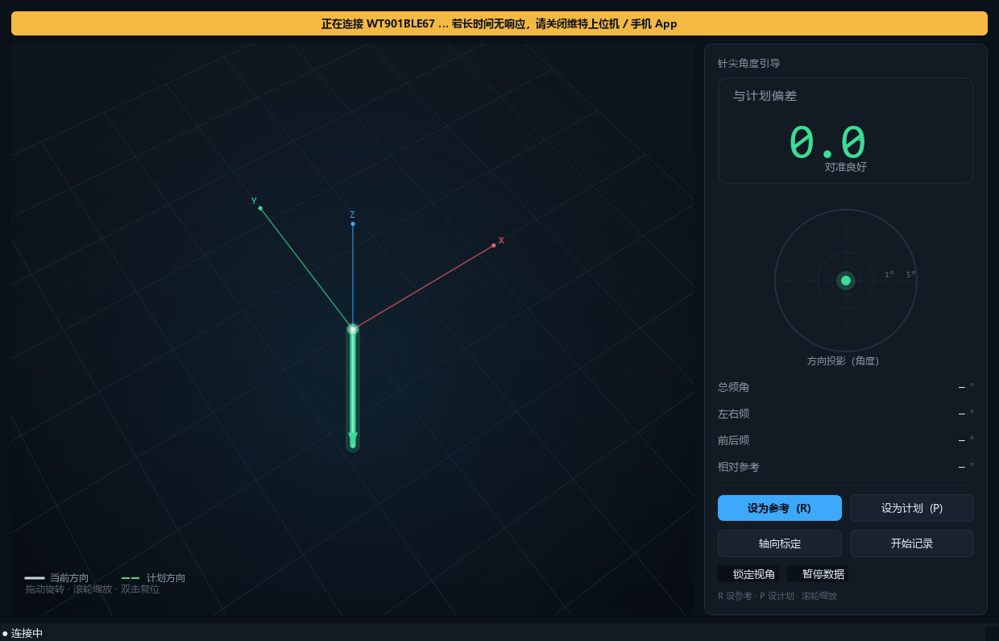
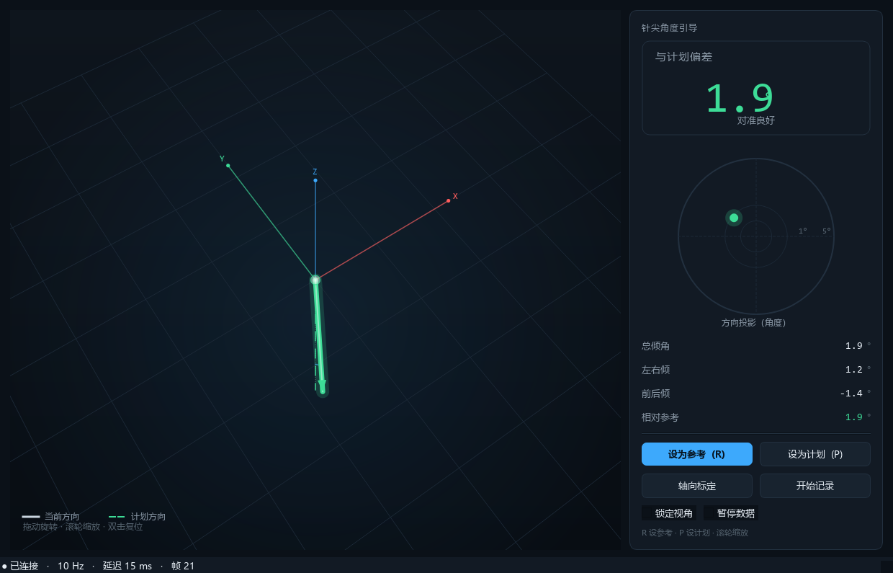

# BLE 通信参数（WT901BLE67 实测）

> 本文所有参数都来自 **2026-11-05 对本机这台传感器的实测**，不是手册抄录。
> 复现命令：`wt901.cmd probe --name WT901BLE67 --duration 6`

---

## 1. 参数总表（可直接抄）

| 项 | 值 |
| --- | --- |
| 设备名 | `WT901BLE67` |
| 设备地址 | `EA:D7:22:40:D3:0A`（随机静态地址，以 `scan` 为准） |
| 服务 UUID | `0000ffe5-0000-1000-8000-00805f9a34fb` |
| 数据通知 UUID | `0000ffe4-0000-1000-8000-00805f9a34fb`（notify） |
| 写入 UUID | `0000ffe9-0000-1000-8000-00805f9a34fb`（write / write-without-response） |
| 数据帧 | `0x55 0x61`，**20 字节**，无校验和 |
| 输出速率（实测） | **10 Hz**（出厂默认） |
| 数据带宽 | ≈ 200 B/s |
| 加速度量程 | ±16 g（实测静置 `|a| = 1.003 g`） |
| 角速度量程 | ±2000 °/s |
| 角度量程 | ±180 ° |
| 是否需要解锁指令 | **不需要**，订阅后立刻推流 |
| 配对方式 | Windows 蓝牙"添加设备"即可，`bleak` 直接连接 |

> 注意 UUID 的基址是 `...9a34fb`（维特自定义），不是标准的 `9b34fb`。
> 代码里按 **16 位短 UUID** 匹配（`ffe4`），两种基址都能识别。

## 2. GATT 结构（probe 原始输出）

```
services:
  00001800-0000-1000-8000-00805f9b34fb      Generic Access
  00001801-0000-1000-8000-00805f9b34fb      Generic Attribute
  0000ffe5-0000-1000-8000-00805f9a34fb      WitMotion 数据服务

characteristics:
  00002a00  write, read                     设备名
  00002a01  read                            外观
  00002a04  read                            首选连接参数
  00002aa6  read                            Central Address Resolution
  0000ffe9  write, write-without-response   命令写入（FF AA 协议）
  0000ffe4  notify                          传感器数据（唯一通知源）
```

实测 6 秒收到 **1200 字节 = 60 帧**，`bad_sum=0 bad_hdr=0`。

## 3. 数据帧格式

### 3.1 当前设备：`0x55 0x61` 合并帧（20 字节）

| 偏移 | 长度 | 内容 |
| --- | --- | --- |
| 0 | 1 | `0x55` 帧头 |
| 1 | 1 | `0x61` 类型 |
| 2–7 | 6 | AX, AY, AZ（int16 小端） |
| 8–13 | 6 | GX, GY, GZ（int16 小端） |
| 14–19 | 6 | Roll, Pitch, Yaw（int16 小端） |

换算：

```
accel[g]   = raw / 32768 * 16
gyro[dps]  = raw / 32768 * 2000
angle[deg] = raw / 32768 * 180
```

**没有校验字节**（2 + 9×2 = 20），所以只能做量程合理性检查，无法做逐帧校验。

### 3.2 备用：`0x55 0x51/0x52/0x53` 分帧（11 字节，带校验和）

如果以后把设备配置成"分开输出"，每帧 11 字节：
`55 53 + 6 字节数据 + 2 字节附加 + 1 字节 SUM`，`SUM = 前 10 字节之和 & 0xFF`。
SDK 已同时支持，不需要改代码。

### 3.3 四元数：`0x55 0x59`（11 字节，带校验和）

```
55 59 Q0L Q0H Q1L Q1H Q2L Q2H Q3L Q3H SUM
SUM = 前 10 字节之和 & 0xFF
Q0 = w, Q1 = x, Q2 = y, Q3 = z, 每个分量 = int16 / 32768
```

SDK 已支持该帧；收到后会填充 `ImuSample.qw/qx/qy/qz` 与
`ImuReading.quaternion`，针体界面优先使用四元数，不再从欧拉角现算。
若设备是"读寄存器"方式（`FF AA 27 51 00` → `55 71 51 00 ...`），
当前版本暂未把 `0x71` 寄存器应答接入连续流；拿到实物原始帧后可再加。

### 3.4 调整输出率（延迟/带宽的取舍）

默认 10 Hz 的采样周期是 100 ms，本身就是平均 50 ms 的延迟。链路和上位机都稳定后，
可以用显式命令把设备设到 50 Hz：

```powershell
python -m wt901 rate --hz 50 --save     # 50 Hz 并写入设备
python -m wt901 rate --hz 100           # 只改本次运行，不保存
```

对应寄存器写法：`FF AA 03 08 00 B4`（50 Hz，最后一字节为 SUM），`FF AA 00 00 00 A9` 保存。
**不要在上位机还跟不上时直接提高 ODR**：如果 GUI 逐帧排队，50 Hz 会让延迟更快增长；
先看 docs/09 的“最新值覆盖”，再看状态栏的 `延迟/丢帧/渲染`。

## 4. 连接时序（Windows 实测）

| 阶段 | 耗时 | 说明 |
| --- | --- | --- |
| 过滤扫描（找设备） | 2.5–6 s | 设备广播间隔决定，存在波动 |
| 连接（用扫描到的设备对象） | ≈ 5 s | 首选路径 |
| 连接（只用地址字符串） | ≈ 11 s | 兜底路径，WinRT 需要重新解析 |
| 首次启动到出数据 | 10–13 s | 扫描 + 连接 |
| 再次启动 | 5–10 s | 有设备缓存，跳过完整扫描 |
| 断线重连 | 2 s 起，×1.6，上限 15 s | 自动，不需要人工干预 |

> 结论：**别指望秒连**。GUI 在连接期间显示"查找 WT901BLE67 …"，不会卡界面。

## 5. 设备缓存

首次连上后会写：

```
%LOCALAPPDATA%\wt901-control\last_device.json
{"address": "EA:D7:22:40:D3:0A", "name": "WT901BLE67", "notify_uuid": "0000ffe4-..."}
```

下次启动优先直连该地址；失败再按名字扫描。删除该文件即可强制重新扫描。

## 6. 写入协议（FF AA，当前未启用）

给后续"改速率/改输出内容"预留，帧格式：

```
FF AA <reg> <data_l> <data_h> <sum>        sum = (FF+AA+reg+datal+datah) & 0xFF
```

`wt901.ble` 提供：

| 函数 | 说明 |
| --- | --- |
| `wit_frame(reg, value)` | 构造写帧 |
| `wit_save()` | `FF AA 00 00 00 00` 保存设置 |
| `wit_unlock()` | `FF AA 69 88 B5`，部分模块的解锁指令（本机不需要） |

**重要**：寄存器编号与取值含义（例如 0x03 输出速率）请以维特官方手册和厂商上位机的实际行为为准，
本机尚未验证写入，代码也不自动写设备。要改速率，建议先用厂商上位机改一次，再用 `probe` 复测。

## 7. 诊断命令

```bat
wt901.cmd scan                                  :: 列出附近设备
wt901.cmd probe --name WT901BLE67 --duration 6  :: GATT + 帧格式 + 速率 + 量程
wt901.cmd analyze --file docs\capture_wt901ble67.bin   :: 离线复算抓包
```

`docs/capture_wt901ble67.bin` 是本次实测抓到的 1200 字节原始数据，可用于回归测试。

## 8. 故障实录：GUI 一直“连接中”/ 25 s 超时

**2026-11-05 实际发生过的原因**（已复现并验证修复）：

| 现象 | 结论 |
| --- | --- |
| GUI 状态栏一直“连接中”，旧版本 25 s 后报超时 | 设备被占用，连不上 |
| `wt901 probe` 扫描列表里**根本没有** WT901BLE67 | 设备停止广播 |
| `Get-PnpDevice -Class Bluetooth` 仍能看到 WT901BLE67（Status=OK） | Windows 保留了配对记录，但链路被别人占着 |
| 任务管理器里有一个 `WitMotion.exe`（深圳维特智能科技有限公司） | **就是它占着 BLE 连接** |

原因链：维特上位机连上传感器 → BLE 外设同一时刻只允许一个连接，且**连接期间停止广播** →
Windows/WinRT 枚举不到该设备 → `BleakDeviceNotFoundError` → 我们的程序等不到首帧 → 超时。

处理：

1. 关闭维特上位机（任务管理器结束 `WitMotion.exe`），手机上的 App 也要断开；
2. 本程序会自动重试，**无需重启**，几秒到十几秒内自动连上；
3. 复测：`wt901.cmd probe --name WT901BLE67 --duration 6`。

界面在两个阶段的样子：

| 被占用时 | 释放后自动恢复 |
| --- | --- |
|  |  |

> 代码已针对这个场景改进：worker 不再在超时后退出，而是持续重试并在状态栏显示
> “连接中/重连中/第 N 次重试”；错误信息直接提示“可能被上位机/手机 App 占用”。

## 9. 已知限制

1. **同一时间只能有一个连接**：厂商上位机/手机 App 连着时，本程序连不上，会一直重试（现在会自动恢复）。
2. **10 Hz 偏低**：界面有 60 ms 平滑，看起来还行；需要更顺可改设备输出速率（见第 6 节）。
3. **地址可能变化**：随机静态地址在重新配对/换适配器后可能改变，缓存失效时会自动回落到名字扫描。
4. **无校验帧**：`0x61` 没有校验和，偶发误码只能靠量程检查和后续滤波挡掉。
5. **Windows 蓝牙栈**：USB 蓝牙适配器的省电设置可能导致断连，必要时在设备管理器里关闭"允许计算机关闭此设备以节约电源"。
